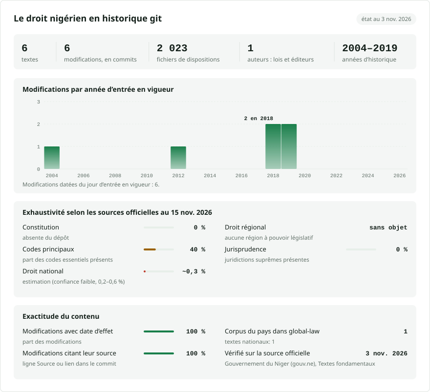

# Niger : l’histoire du droit dans git

**Français** · [English](README.en.md)

<picture>
<source media="(prefers-color-scheme: dark)" srcset="data/fr/effort-dark.svg">

</picture>

Le droit du Niger sous la forme d’un historique git : un fichier par article, un commit par version à la date de son entrée en vigueur, et la loi auteur de chaque modification comme auteur du commit. `git blame` indique la loi à l’origine de chaque ligne ; `git log` liste toutes les modifications d’un article ; le choix d’une date donne le texte en vigueur ce jour-là.

Fait partie de [lexifina/global-law](https://github.com/lexifina/global-law), un historique git unique pour le droit de tous les pays : il s’agit ici du droit national du Niger, que global-law lit sous `niger/national/acts/`.

**Contenu actuel :** six textes, chacun en une version et aucun n’ayant encore d’historique de modifications : la Constitution du 25 novembre 2010 telle que modifiée jusqu’en 2018 (le préambule, 185 articles et l’article 99 bis) ; le Code pénal dans l’édition du Ministère de la Justice de janvier 2018 ; le Code de procédure pénale tel que modifié jusqu’en 2004 (749 articles) ; le Code du travail tel qu’adopté en 2012 (365 articles) ; et la Charte des partis politiques et le Code électoral, chacun tel que modifié jusqu’en 2019. Le `README.md` de chaque texte liste ses dispositions.

**Ce n’est pas le droit en vigueur aujourd’hui.** La Constitution a été suspendue après la prise du pouvoir par les militaires le 26 juillet 2023, le Code pénal aurait été remplacé en 2026, et les modifications ultérieures des autres textes ne sont pas appliquées (voir [Ce qu’il ne montre pas](#ce-quil-ne-montre-pas)).

Chaque texte a son propre dossier avec un fichier par article (`code-du-travail/art-116.md` est l’article 116 du Code du travail, relatif aux congés payés ; `constitution/art-099-bis.md` est l’article 99 bis). Le préambule et les intitulés des titres de la Constitution sont `preamble.md` et `titre-01.md` à `titre-14.md` ; les intitulés du Code pénal sont les fichiers `part-*.md` ; le Code électoral et la Charte des partis politiques tiennent chacun en un seul fichier, `texte-integral.md`.

Le texte est en français, tel que ses sources l’impriment. Une traduction anglaise ne fait pas partie de ce corpus.

## Questions sous forme de commandes git

| Question | Commande |
| --- | --- |
| Toutes les modifications de l’article 116 du Code du travail (congés payés) | `git log -p --word-diff -- code-du-travail/art-116.md` |
| Quelle loi a rédigé chaque ligne de l’article 116 ? | `git blame code-du-travail/art-116.md` |
| Toutes les versions de l’article 116, avec la date d’entrée en vigueur de chacune | `git log --format="%h %(trailers:key=In-force,valueonly,separator=) %an" -- code-du-travail/art-116.md` |
| L’article 116 au 1er janvier 2015, tel que ce corpus le contient | `python tools/on.py 2015-01-01 code-du-travail art-116` |

**En dehors de git**, nous hébergeons aussi ce corpus publiquement, gratuitement :

- **[Interroger Claude sur le droit du Niger](https://global-law.lexifina.com/v1/try_claude?country=niger)** : ouvre Claude avec une première question prête.
- **[Interroger ChatGPT](https://global-law.lexifina.com/v1/try_chatgpt?country=niger)** : la même question dans ChatGPT.
- **[Rechercher dans le droit du Niger sur notre site](https://lexifina.com/law?country=niger&q=cong%C3%A9+pay%C3%A9)** : une recherche de « congé payé », avec le texte de chaque disposition et ses versions, sans compte.
- **[API REST pour développeurs](https://global-law.lexifina.com/v1/search_law?query=cong%C3%A9+pay%C3%A9&jurisdiction=niger)** : la même recherche au format JSON, sans clé. Voir la [documentation ici](https://lexifina.com/api/global-law).

Les deux assistants lisent le corpus au moyen du connecteur gratuit Global law (MCP, `https://global-law.lexifina.com/mcp`) ; la première fois, la conversation vous donne le lien qui l’ajoute. Posez vos questions en français ou en anglais.

**L’héberger vous-même, simplement.** Il suffit de git et de Python, et les outils s’exécutent sur votre machine :

```sh
git clone --depth 1 https://github.com/lexifina/global-law && cd global-law
python3 tools/countries.py add niger/national/acts
python3 tools/law.py show 2026-01-01 niger/national/acts/code-du-travail/art-116.md
```

Ouvert dans Claude Code, Cursor, VS Code ou Codex, le clone démarre aussi un serveur MCP local doté des mêmes outils ([MCP.md](https://github.com/lexifina/global-law/blob/main/MCP.md)).

## Dates

Chaque commit est daté à midi, heure Africa/Niamey, du jour où la version est entrée en vigueur, et porte cette date dans son trailer `In-force:`. Aucune source ne donnant de date d’entrée en vigueur pour sa version :

- la Constitution est datée du 22 juin 2018, date de la loi n°2018-44, dernière loi modificative qu’elle cite ; le Code de procédure pénale du 16 mai 2004, date de la loi n° 2004-21, selon la même règle ;
- le Code du travail est daté du 25 septembre 2012, date de la loi n° 2012-45 (son article 365 ne fait qu’ordonner la publication au Journal officiel) ;
- le Code électoral et la Charte des partis politiques sont datés de la dernière modification qu’impriment leurs PDF (18 juillet 2019 et 17 juin 2019) ;
- le Code pénal est daté du 1er janvier 2018 : son édition ne donne que le mois.

Chaque version est la « plus ancienne version disponible », attribuée à l’éditeur que consigne le dépôt, le Gouvernement du Niger (gouv.ne), Textes fondamentaux, y compris pour les trois textes tirés d’UNODC SHERLOC et de Droit-Afrique ; son message de commit désigne les lois dont, selon la source, le texte est issu (celui de la Constitution cite le décret de promulgation de 2010 et cinq lois modificatives). Le committer est toujours Lexifina.

## Méthode de vérification

- `tools/check_repo.py` relit chaque version dans git le jour de son entrée en vigueur et la veille, et les deux doivent correspondre au corpus à partir duquel l’historique a été construit ; il vérifie aussi que les trailers de chaque commit sont analysables, l’absence de commits de fusion et qu’aucune date de commit ne recule ni ne se situe dans le futur.
- `tools/build.py` écrit l’historique à partir de ce corpus en une seule passe ; une seconde construction dans un dossier vide a donné des empreintes identiques. Les résultats figurent dans [`REPRODUCE.md`](REPRODUCE.md), et [`data/corpus.sha256`](data/corpus.sha256) donne l’empreinte du corpus.
- Le texte est la couche texte propre des PDF, et non une transcription. [`LICENSE`](LICENSE) liste ce qui a été modifié (mise en page, numéros de page, espacement, guillemets et tirets ; notes de modification dans les intitulés d’articles omises), et `REPRODUCE.md` les choix faits manuellement pour chaque texte.
- [vulnerabilities/](vulnerabilities/): erreurs de rédaction possibles dans ce droit, trouvées par les détecteurs de global-law et vérifiées à la main. Pas encore lancé.

## Ce qu’il ne montre pas

- **Le droit en vigueur aujourd’hui.** La Constitution de la VIIe République a été suspendue après le 26 juillet 2023 et remplacée par les textes propres à la transition. L’ordonnance n°2026-09 du 16 février 2026 portant institution du Code pénal aurait remplacé le Code pénal ; son texte ne figure pas ici.
- **Les modifications ultérieures.** Le Code de procédure pénale ne comporte pas celles postérieures à 2004 (parmi lesquelles la loi n° 2019-55 du 22 novembre 2019) ; le Code du travail, celles postérieures à 2012, ni sa partie réglementaire (décret n° 2017-682/PRN/MET/PS).
- **Les rédactions antérieures.** La Constitution intègre déjà les modifications de 2011, 2017 et 2018 ; le portail ne donne aucune rédaction antérieure des articles modifiés.
- **Les articles que les éditions n’impriment pas.** Le Code de procédure pénale omet les articles 310 à 317, 736, 737 et 739 à 741 ; deux numéros mal imprimés sont classés sous `art-717` et `art-679-01`.
- **Les autres textes.** Aucun code civil ni code de commerce n’a été trouvé en ligne sous forme de texte officiel (le droit commercial relève en grande partie des Actes uniformes de l’OHADA), et il n’y a pas de jurisprudence.

## Sources

| Source | Nature | Versions antérieures | Remarques |
| --- | --- | --- | --- |
| [gouv.ne](https://www.gouv.ne), Textes fondamentaux (Gouvernement du Niger) | Portail gouvernemental : PDF officiels | non, un texte consolidé chacun | La Constitution (jusqu’en 2018), le Code électoral et la Charte des partis politiques (jusqu’en 2019) |
| [UNODC SHERLOC](https://sherloc.unodc.org) | Copies de PDF nationaux | non, une édition chacun | Le Code pénal (édition du Ministère de la Justice, janvier 2018) et le Code de procédure pénale (jusqu’en 2004) |
| [Droit-Afrique](http://web.archive.org/web/20160615103820/http://www.droit-afrique.com:80/upload/doc/niger/Niger-Code-2012-du-travail.pdf) (copie de l’Internet Archive du 15 juin 2016) | Éditeur de textes juridiques africains | non, le Code tel qu’adopté | Le Code du travail de 2012 |

## Licence

Voir [`LICENSE`](LICENSE). Les textes juridiques relèvent du droit public de la République du Niger et sont reproduits avec mention de chaque source ; aucune source n’indique de licence, et l’article 6(i) de l’Annexe VII de l’Accord de Bangui, applicable au Niger en tant que membre de l’OAPI, exclut les textes législatifs officiels de la protection du droit d’auteur. L’historique, les messages de commit, les tableaux et les outils sont sous licence CC0 1.0.

Aucun modèle d’IA n’a rédigé, traduit ni corrigé de texte juridique, et aucun ne s’exécute lors de la construction de l’historique ; les scripts ont été écrits par un modèle d’IA (voir [`REPRODUCE.md`](REPRODUCE.md)).

Ceci est une traduction de la version anglaise ([README.en.md](README.en.md)) ; en cas de divergence, la version anglaise fait foi.

## Visualisations

- [visualisations/](visualisations/): graphiques tirés de ce dépôt. Pas encore dessinés.

## En savoir plus

Dans le dépôt [lexifina/global-law](https://github.com/lexifina/global-law) (pages en anglais) :

- [FEATURES.md](https://github.com/lexifina/global-law/blob/main/FEATURES.md): toutes les fonctionnalités et ce que chaque corpus doit prendre en charge (`git blame`, `law.py`, outils MCP)
- [FAQ.md](https://github.com/lexifina/global-law/blob/main/FAQ.md): questions et réponses · [CONTRIBUTING.md](https://github.com/lexifina/global-law/blob/main/CONTRIBUTING.md): proposer une modification · [MCP.md](https://github.com/lexifina/global-law/blob/main/MCP.md): serveur MCP · [REPRODUCE.md](https://github.com/lexifina/global-law/blob/main/REPRODUCE.md): comment il a été construit · [CHANGELOG.md](https://github.com/lexifina/global-law/blob/main/CHANGELOG.md)
- [FRESHNESS.md](https://github.com/lexifina/global-law/blob/main/FRESHNESS.md): à quel point chaque corpus est à jour · [Surveillance](https://github.com/lexifina/global-law/tree/main/monitoring): si les mises à jour fonctionnent · [WATCHING.md](https://github.com/lexifina/global-law/blob/main/WATCHING.md): comment chaque source officielle est surveillée pour repérer les modifications
- [performance/](https://github.com/lexifina/global-law/tree/main/performance): la rapidité des outils, mesurée
- [visualisations/](https://github.com/lexifina/global-law/tree/main/visualisations): graphiques et liens à travers le droit du monde entier
- [Vulnérabilités](https://github.com/lexifina/global-law/tree/main/vulnerabilities): erreurs dans les textes tels qu’ils ont été publiés
